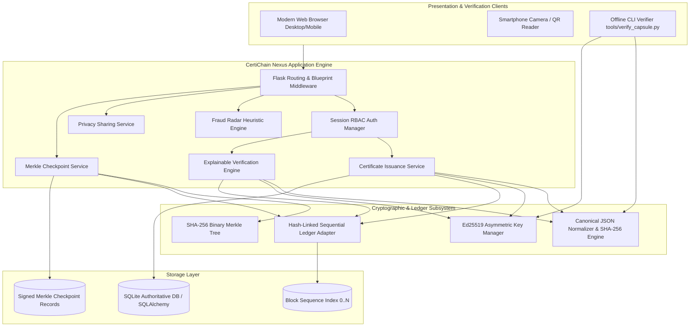
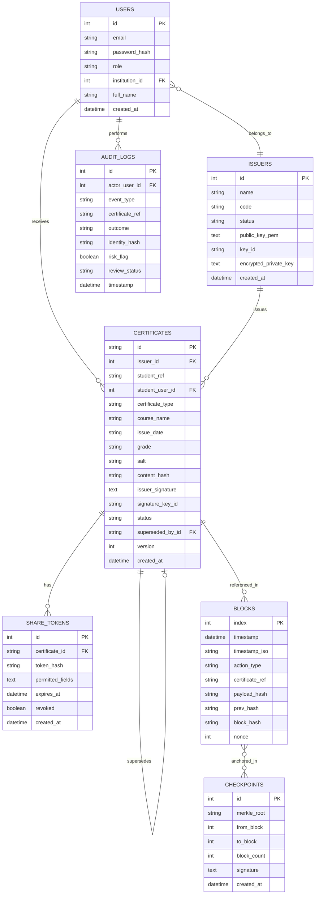
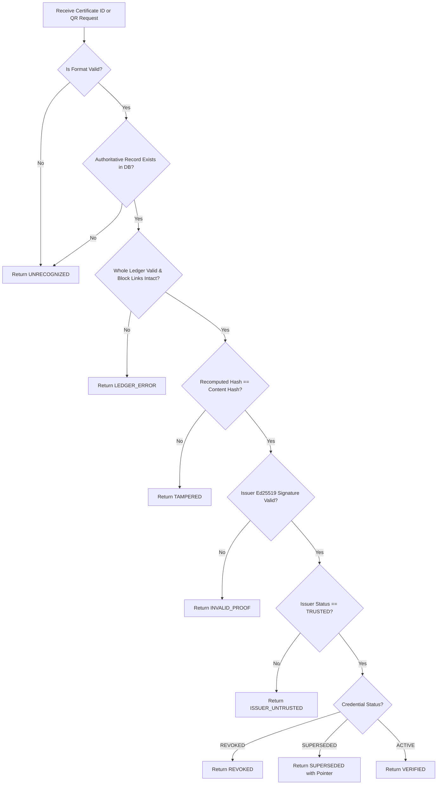

# CertiChain Nexus: Academic Project Report

**Project Title:** Blockchain-Based Certificate Verification System with Explainable Trust Analysis and Fraud Detection  
**Category:** Cybersecurity, Distributed Ledgers, Digital Credentials, Applied Cryptography  
**Academic Year:** 2025–2026  

---

## 1. Abstract
The proliferation of fraudulent educational certificates, altered transcripts, and unverified credentials imposes significant financial and reputational liabilities on universities, employers, and licensing bodies. Conventional verification architectures either depend on slow, bureaucratic manual checks or centralized database queries that fail to protect against insider database tampering or invisible post-graduation revocations. 

**CertiChain Nexus** introduces an end-to-end digital credentialing platform featuring a custom hash-linked append-only blockchain ledger, asymmetric Ed25519 digital signatures, salted SHA-256 commitments, periodic Merkle tree checkpointing, and an Explainable Trust Engine. Rather than rendering opaque boolean outputs, the system evaluates credentials against a formal 7-tier status-precedence hierarchy, generating human-readable explanations, granular cryptographic verification matrices, and chronological trust timelines. Furthermore, the platform integrates student-governed selective disclosure share links and a heuristic Fraud Radar to detect anomalous verification patterns. The system is implemented in Python and Flask, verified with a comprehensive 20-test automated suite and automated browser walkthroughs across desktop and mobile viewports.

---

## 2. Introduction
In modern higher education and global talent acquisition, academic and professional credentials represent the bedrock of qualified hiring. However, digital desktop publishing software and high-resolution generative editing tools have democratized the forgery of degrees, diplomas, and certifications. 

CertiChain Nexus addresses this challenge by establishing an immutable audit trail between accredited issuing authorities and verifiers. By decoupling the cryptographic verification engine from proprietary storage and offering portable, client-verifiable Proof Capsules, the platform ensures that certificates can be authenticated both online through dynamic QR scanning and completely offline using standalone cryptographic utilities.

---

## 3. Problem Statement
Existing verification methodologies present four core vulnerabilities:
1. **Physical & PDF Vulnerability:** Physical certificates and static PDFs possess no cryptographic tamper-evident properties; altered grades or student names cannot be detected without contacting the issuing university.
2. **The Database Insider Attack:** Centralized relational database systems trust system administrators implicitly. A rogue administrator or compromised server credential allows historical records to be rewritten with zero external auditability.
3. **Revocation Invisibility:** Traditional credentials lack automated synchronization with university records when credentials are revoked due to plagiarism, fraud, or disciplinary rulings.
4. **Binary & Unexplainable Outputs:** Existing web verification tools display a generic "Invalid" flag without specifying whether the failure originated from a corrupted block, an untrusted issuer, a payload mismatch, or an expired link.

---

## 4. Existing System vs. Proposed System

| Dimension | Conventional Verification Systems | CertiChain Nexus Proposed System |
|---|---|---|
| **Storage Architecture** | Centralized Relational SQL | Dual Layer: Relational State + Append-Only Hash-Linked Ledger |
| **Tamper Evidence** | Database access logs (alterable) | Cryptographic SHA-256 Block Linking + Merkle Checkpoint Roots |
| **Authority Proof** | Static institution logo / seal | Asymmetric Ed25519 Digital Signatures per accredited issuer |
| **Revocation Model** | Row deletion or silent flag update | Immutable `CERTIFICATE_REVOKED` append-only ledger block |
| **Verification Output** | Bare Boolean (`Valid` / `Invalid`) | Structured Explainable Trust Result with 5-point inspection matrix |
| **Privacy Sharing** | All-or-nothing credential view | Selective disclosure with hashed random token commitments |
| **Offline Validation** | Impossible (requires server access) | Standalone JSON Proof Capsules with CLI & Browser verifiers |

---

## 5. Objectives & Project Scope

### Objectives
1. Implement a tamper-evident, append-only hash-linked blockchain ledger in pure Python.
2. Integrate Ed25519 asymmetric cryptography to bind certificate content hashes to accredited institution keys.
3. Formulate an Explainable Trust Engine governed by a strict status-precedence policy.
4. Provide portable Proof Capsules enabling offline mathematical verification without network calls.
5. Engineer a rule-based Fraud Radar to detect verification anomalies and repeated tampering attempts.

### Project Scope
- Designed as a demo-ready, college mini-project running locally on standard laptop hardware with Python 3.10+ and modern web browsers.
- Focuses on local ledger simulation and Merkle checkpoint anchoring without requiring paid public blockchain gas fees or cloud API keys.

---

## 6. System Architecture



---

## 7. Data-Flow Diagram (DFD Level 1)

```mermaid
flowchart LR
    Issuer[Accredited Institution] -->|Submit Student & Course Data| IssueProcess((1.0 Issue & Sign Certificate))
    IssueProcess -->|Salt + Canonical Fields| HashProcess((2.0 SHA-256 Hash))
    HashProcess -->|Content Hash| SignProcess((3.0 Ed25519 Sign))
    SignProcess -->|Certificate & Block Record| DB[(Authoritative Database & Ledger)]
    
    Verifier[Public Verifier / Employer] -->|Enter ID or Scan QR| VerifyProcess((4.0 Explainable Verification))
    DB -->|Read Cert, Issuer Key & Blocks| VerifyProcess
    VerifyProcess -->|Evaluate 7-Tier Precedence| ResultView[Explainable Trust Matrix]
    VerifyProcess -->|Write Event| AuditDB[(Privacy Audit Log)]
    
    AuditDB -->|Windowed Log Stream| FraudProcess((5.0 Fraud Radar Rules))
    FraudProcess -->|Heuristic Anomaly Alerts| AdminDashboard[Security Radar Console]
```



---

## 8. Entity-Relationship (ER) Diagram



---

## 9. Cryptographic Hashing Specification

To prevent serialization inconsistencies across varying platforms, canonical formatting is enforced before SHA-256 calculation:

1. **Normalization Rules:**
   - Text fields are stripped of leading/trailing whitespace and normalized to Unicode Normalization Form C (`NFC`).
   - `certificate_id` is forced to uppercase.
   - `grade` is preserved as a normalized string (or empty string if omitted).
   - Date formats are constrained to ISO-8601 `YYYY-MM-DD`.
2. **Canonical JSON Serialization:**
   - Keys sorted lexicographically in alphabetical order.
   - Zero superfluous whitespace separators (`separators=(',', ':')`).
   - UTF-8 byte encoding.
3. **Commitment Formula:**
$$\text{Payload} = \text{CanonicalJSON}(\{ \text{cert\_id}, \text{course}, \text{type}, \text{grade}, \text{date}, \text{issuer\_id}, \text{salt}, \text{student\_ref} \})$$
$$\text{ContentHash} = \text{SHA256}(\text{Payload})$$
4. **Constant-Time Verification:** Verification compares recomputed digests against recorded hashes using `hmac.compare_digest` to prevent timing side-channel leaks.

---

## 10. Explainable Verification Algorithm & Status Precedence



---

## 11. Empirical Verification & Test Results

The platform was thoroughly verified across automated unit/integration suites and live end-to-end browser walkthroughs.

### Automated Pytest Suite Summary
```
============================= test session starts =============================
platform win32 -- Python 3.11.9, pytest-9.1.1, pluggy-1.6.0
rootdir: D:\Projects\certichain-nexus
configfile: pytest.ini
testpaths: tests
collected 20 items

tests\test_blockchain.py ...                                             [ 15%]
tests\test_capsule.py .                                                  [ 20%]
tests\test_checkpoints.py .                                              [ 25%]
tests\test_cli_offline.py .                                              [ 30%]
tests\test_fraud.py .                                                    [ 35%]
tests\test_hashing.py ..                                                 [ 45%]
tests\test_issuance.py ..                                                [ 55%]
tests\test_merkle.py .                                                   [ 60%]
tests\test_revocation.py ..                                              [ 70%]
tests\test_sharing.py .                                                  [ 75%]
tests\test_signing.py .                                                  [ 80%]
tests\test_verification.py ....                                          [100%]

============================= 20 passed in 14.37s =============================
```

### Browser Subagent E2E Execution
The autonomous browser subagent performed a full user-journey walkthrough covering all four roles:
1. **Landing & ID Search:** Verified search bar routing.
2. **Super Admin Dashboard:** Checked metrics, registered institution approvals, and dynamic Chart.js status distribution.
3. **Issuer Credential Issuance:** Issued certificate `CERT-2026-9592CD2D` for student `STU-2026-TEST-101`, committed Block #11 to the ledger, and verified QR code generation.
4. **Student Vault & Zero-Knowledge Share Links:** Tested field disclosure modal (Course + Date, excluding Grade) with 72-hour expiry token.
5. **Public Verification:** Evaluated `CERT-2026-9592CD2D` on both desktop and 375x812 mobile viewports.
6. **Ledger Tamper Simulation:** Triggered controlled in-memory block corruption on Genesis Block #0, confirming `NO (FAILED AS EXPECTED)` detection.
7. **Fraud Radar Dashboard:** Inspected real-time anomaly alerts including `RULE_REVOKED_CERT_PROBE`.
8. **Proof Capsule Verification:** Uploaded capsule JSON on `/capsule/verify` and validated offline via `tools/verify_capsule.py`.

*Captured Artifacts:*
- WebP Walkthrough Video: `certichain_nexus_demo_1791614891342.webp`
- Public Verification Screenshot: `public_verify_page_1791615973234.png`
- Mobile Viewport Screenshot: `mobile_verify_view_1791616003680.png`

---

## 12. Security Considerations & Honest Limitations

### Security Protections
- **Password Protection:** Werkzeug PBKDF2-SHA256 password hashing.
- **Session Security:** `HttpOnly`, `SameSite=Lax`, and `X-Content-Type-Options: nosniff`.
- **Private Key Encryption:** Issuer Ed25519 private keys encrypted at rest using Fernet with application-derived master keys.
- **Audit Privacy:** Verifier IP addresses and client headers are pseudonymized using salted SHA-256 identity hashes before persistence.

### Honest Limitations
1. **Local vs. Public Blockchain:** CertiChain Nexus utilizes a custom Python hash-linked ledger. While cryptographically identical to blockchain block structures, it does not employ decentralized consensus (Proof of Work or Proof of Stake).
2. **Privileged Administrator Bound:** A malicious actor with full operating system and database root access could simultaneously alter both the SQL records and the local block chain. This limitation is directly mitigated by Innovation G: exporting signed Merkle checkpoints to external repositories (e.g. GitHub Gists or cold storage).
3. **Key Compromise:** If an institution's private key is leaked, unauthorized valid certificates could be signed until the institution is suspended in the admin console.

---

## 13. Future Enhancements
1. **Public Blockchain Anchoring:** Deploy an Ethereum / Polygon ERC-721 or smart-contract adapter to anchor Merkle roots on a decentralized public ledger.
2. **W3C Verifiable Credentials (VCs):** Standardize JSON Proof Capsules into W3C VC and DID (Decentralized Identifier) formats.
3. **Zero-Knowledge Range Proofs:** Enable students to prove their GPA exceeds a threshold (e.g., GPA > 3.5) without disclosing their exact grade.
4. **Hardware Security Module (HSM) Integration:** Store issuer private keys in FIPS 140-2 Level 3 compliant cloud hardware security modules.

---

## 14. Conclusion
CertiChain Nexus successfully proves that digital credential verification can be transparent, explainable, and tamper-resistant without relying on costly enterprise public blockchains. By bridging asymmetric Ed25519 signatures, append-only ledger blocks, Merkle checkpointing, and privacy-preserving sharing, the system offers an airtight, demo-ready framework for higher education and enterprise credentialing.

---

## 15. References
1. Nakamoto, S. (2008). *Bitcoin: A Peer-to-Peer Electronic Cash System.*
2. Merkle, R. C. (1987). *A Digital Signature Based on a Conventional Encryption Function.* Advances in Cryptology — CRYPTO ’87.
3. Bernstein, D. J., Duif, N., Lange, T., Schwabe, P., & Yang, B. Y. (2012). *High-speed high-security signatures.* Journal of Cryptographic Engineering, 2(2), 77-89.
4. W3C Recommendation. (2022). *Verifiable Credentials Data Model v1.1.* World Wide Web Consortium.
